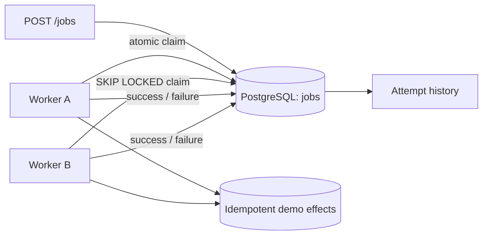

# Reliable Job Processor — .NET 10 + PostgreSQL

A small, **production-pattern portfolio demo** of durable background job execution with multiple competing workers. It demonstrates concurrency control, scheduling, lease recovery, exponential backoff, idempotency, and an auditable attempt history.

**What this proves to a hiring team:** I can reason about failure modes and engineer reliable asynchronous workflows—not just implement a `BackgroundService` loop.

> This is an independently written educational project, not a copy of an employer's code and not a production-ready queuing service.

## Stack

- **.NET 10 / ASP.NET Core Minimal API**, `BackgroundService`, C#
- **PostgreSQL 17**, `FOR UPDATE SKIP LOCKED`, transactional state changes
- **Npgsql 10**, parameterized SQL without an ORM
- Docker Compose, GitHub Actions, dependency-light C# tests

## Architecture



**Job lifecycle**

```text
queued --atomic claim--> running --success--> succeeded
                            |
                     failure or expired lease
                            |
                   budget remaining? ------- no ---> dead
                            |
                           yes
                            v
                queued (backoff delay)
```

## Run it in about 3 commands

### Option A — Docker (requires Docker Desktop / Docker Engine)

```bash
docker compose up --build -d
curl http://localhost:5081/health
```

Submit a job:

```bash
curl -i -X POST http://localhost:5081/jobs \
  -H 'Content-Type: application/json' \
  -d '{"kind":"sum","payload":{"numbers":[3,4,5]},"idempotencyKey":"demo-001"}'
```

The response is **201 Created** with a job UUID. Repeat exactly the same request to get **200 OK** with `reused: true`; send a *different* payload with the same key to get **409 Conflict**.

```bash
curl http://localhost:5081/jobs
# use a real id returned by POST:
curl http://localhost:5081/jobs/<JOB_ID>
curl http://localhost:5081/jobs/<JOB_ID>/attempts
```

Stop containers with `docker compose down`. Add `-v` to delete the *local demonstration* database (destructive).

### Option B — Local .NET SDK + PostgreSQL container

```bash
docker compose up -d db
dotnet run --project src/ReliableJobs.Api -- --urls http://localhost:5081
```

`appsettings.Development.json` contains intentionally local-only demo credentials. Use environment variables or a secret manager for anything beyond local development. To run in production mode, configure `ConnectionStrings__Jobs` explicitly.

### Run a second worker to demonstrate competing consumers

In a separate terminal while the API is running:

```bash
# Using a local SDK, with the same PostgreSQL connection:
dotnet run --project src/ReliableJobs.Api -- --urls http://localhost:5082
```

Both processes point to the same database, but a queued job can be claimed by **only one worker at a time**. The server also exposes HTTP on 5082; the DB claim transaction, not process affinity, provides the concurrency safety. Start several delayed jobs to watch the two processes process different work.

## Demo job types

| Kind | Example payload | Behavior |
|---|---|---|
| `sum` | `{"numbers":[3,4,5]}` | Compute `12`, persist JSON result once |
| `flaky` | `{"failUntilAttempt":2}` | Fail first two attempts, succeed on third |
| `delay` | `{"milliseconds":1000}` | Bounded asynchronous delay (up to 5 seconds) |

The handlers perform no external calls and use only synthetic payloads. Each successful job writes a single row to the `job_effects` table; `PRIMARY KEY(job_id)` makes this demonstration effect idempotent if the job is replayed after a worker crash.

## HTTP endpoints

| Method | Path | Function |
|---|---|---|
| `POST` | `/jobs` | Enqueue now or schedule (up to 7 days), optional idempotency key |
| `GET` | `/jobs?status=dead&limit=20` | List jobs; filter by status |
| `GET` | `/jobs/{id}` | Inspect status, attempts, output, last failure |
| `GET` | `/jobs/{id}/attempts` | Inspect individual executions and errors |
| `POST` | `/jobs/{id}/retry` | Manually requeue a **dead** job with 3 additional attempts |
| `GET` | `/health` | Database readiness probe |

See [`demo.http`](demo.http) for ready-to-run examples.

## Testing

```bash
# Pure C# tests (no database required):
dotnet run --project tests/ReliableJobs.Tests

# Database integration tests (uses a temporary, isolated PostgreSQL schema):
# Bash / WSL example:
export TEST_POSTGRES='Host=localhost;Port=5432;Database=reliable_jobs;Username=demo;Password=demo_local_only'
dotnet run --project tests/ReliableJobs.Tests
```

Integration checks cover:

- Concurrent `SKIP LOCKED` claims across independent connections
- Producer deduplication, conflicting idempotency keys
- Attempt history, failures, dead-letter state, manual retries
- Rejection of expired/stale lease acknowledgments
- Crash recovery (forced lease expiry) and idempotent effect insertion

CI starts PostgreSQL, compiles both projects and executes all tests. The tests require permission to create and drop a temporary schema; they do not delete user jobs.

## Design choices that matter

| Choice | Reason |
|---|---|
| PostgreSQL, not an in-memory `Channel` | Work survives process termination and supports several worker instances |
| `FOR UPDATE SKIP LOCKED` | Atomic row-level claims without a global process lock |
| Short-lived database transaction | Claims aren't held open throughout the handler execution |
| Lease token checked on completion | Reject late acknowledgments from a worker that lost ownership |
| Automatic lease recovery | Restart recovery for jobs stranded as `running` |
| Exponential backoff / retry budget | Prevent tight retry loops and avoid infinite poison-job retries |
| Unique idempotency key | Prevent repeat submissions for the same logical request |
| Unique persisted effect per job | Demonstrate idempotent replays, not claim universal exactly-once execution |
| Separate attempts table | Interview-friendly audit trail for each attempt and terminal state |

## Important limitations

- **At-least-once, not exactly-once:** a crashed worker might execute an action then fail before acknowledging. External actions (payments, emails, HTTP calls) require provider-side idempotency or an outbox pattern. Lease fencing prevents stale *acknowledgments*, not all external side effects.
- The demo uses a 30-second lease and caps handlers at 5 seconds. For real long-running work, implement periodic lease renewal, worker liveness, and robust cancellation handling.
- It polls every 500 ms rather than using LISTEN/NOTIFY or a broker. This is fine at demo scale, not high-throughput production scale.
- This is a **local demonstration without authentication, authorization, rate limits, metrics, tracing, DLQ alerts, API quotas, or versioned schema migrations**. Do not expose these mutation endpoints publicly.
- A PostgreSQL database can become a bottleneck at sufficiently high scale; a managed message broker would be a legitimate alternative.
- Manual retry grants three more attempts and preserves the original attempt numbers and history; it doesn't undo prior side effects.
- `CREATE TABLE IF NOT EXISTS` is an intentionally minimal development bootstrap, not a migration strategy.
- The code has **not been compiled/executed in the artifact-generation environment** (no .NET SDK or Docker available). Verify the GitHub Actions check before highlighting the project as passing CI.

Further details: [ARCHITECTURE.md](ARCHITECTURE.md), including failure-mode analysis and discussion prompts.
# reliable-job-processor
